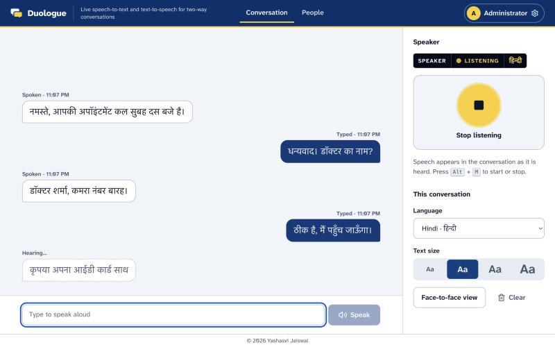
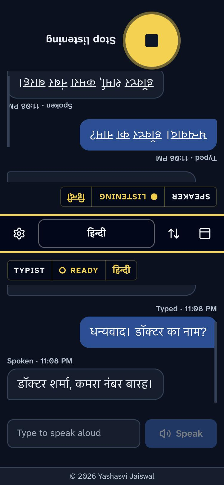
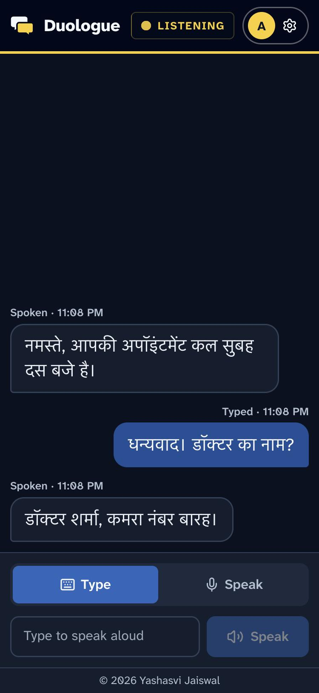
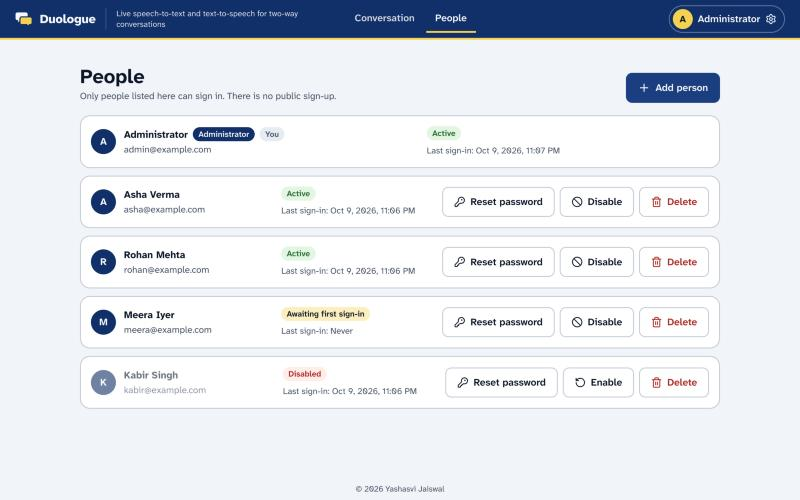
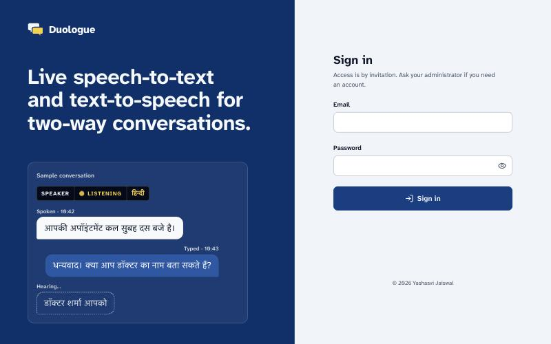

# Duologue

**Live speech-to-text and text-to-speech for two-way conversations.**

Duologue lets a person who types and a person who speaks hold one conversation, in person or on a call, without an interpreter or a notepad. What the speaker says appears as live text. What the other person types is read aloud. It is built for Indian languages and code-switching (Hindi, Hinglish, Tamil, Telugu and more) as well as English, and was designed with deaf and hard-of-hearing users in mind.



<sub>Screenshots use sample data and a simulated transcription feed.</sub>

## How it works

- **Speaker side:** tap the microphone. Speech is transcribed live, with interim words shown as they are heard.
- **Typist side:** type a message and it is read aloud in the selected language.
- **Status in words:** a station-board style readout on each side always says what that side is doing ("Listening", "Mic off", "Speaking aloud") so nothing depends on sound or colour alone.
- **Languages:** English, Hindi, Hinglish, Bengali, Kannada, Marathi, Tamil, Telugu, Urdu, Gujarati and 14 more Indian languages, plus auto-detect.
- **Readable by design:** adjustable text size, light and dark themes, 48px touch targets and reduced-motion support.
- **Invite-only:** there is no public sign-up. An administrator adds, disables, resets and removes people.

## Two layouts, built for the device

| Face to face (phones and tablets) | Shared (laptops and desktops) |
|---|---|
|  |  |

**Face to face** is for a device lying between two people. The screen splits in two and the far half is rotated 180°, so the person opposite reads their side the right way up, with their own controls near their edge. The seam in the middle is for the device owner.

**Shared** is one conversation. On a laptop it adds a speaker panel (microphone, language, text size) in a side rail, and `Alt + M` starts and stops the microphone. On a phone it keeps the controls within thumb reach with a Type / Speak switch.

Touch devices open in Face to face and everything else in Shared. Switch any time in Settings.

## Access and administration





The administrator can add people (a temporary password is generated and shown once), reset passwords, disable accounts (which signs them out immediately) and delete them. New people must choose their own password at first sign-in.

## Tech

- React 19 and Vite, plain CSS with design tokens (light and dark from one set of `light-dark()` pairs).
- Cloudflare Pages Functions for the API, Cloudflare D1 for users and sessions.
- [Deepgram](https://deepgram.com) for streaming transcription, [Sarvam AI](https://www.sarvam.ai) for Indic transcription and text-to-speech, with the browser's speech synthesis as a fallback.
- API keys stay on the server. The browser only talks to authenticated same-origin proxies.

## Run it locally

```bash
npm install
cp .dev.vars.example .dev.vars   # then fill in the values
npm run api                      # Pages Functions + local D1 on http://localhost:8788
npm run dev                      # Vite on http://localhost:5173 (proxies the API)
```

Sign in as the administrator with `ADMIN_EMAIL` and `ADMIN_INITIAL_PASSWORD` from `.dev.vars`.

## Deploy to Cloudflare Pages

1. Create the database once and paste the printed `database_id` into `wrangler.toml`:
   ```bash
   npx wrangler d1 create duologue
   ```
   Tables are created automatically on first request.
2. In Pages, set these secrets (Settings → Variables and Secrets, or `npx wrangler pages secret put NAME`):
   - `SARVAM_API_KEY`
   - `DEEPGRAM_API_KEY`
   - `ADMIN_INITIAL_PASSWORD`: used for the administrator's first sign-in
   - `ADMIN_EMAIL` (optional): which email is the administrator. The default is set in `functions/_lib/auth.js`.
3. Build command `npm run build`, output directory `dist`. Deploy with `npm run deploy`, or push to the connected branch.

The administrator account is created the first time `ADMIN_EMAIL` signs in with `ADMIN_INITIAL_PASSWORD`. After that the password lives only in the database; change it from Settings.

Lost the admin password? Delete the admin row and the bootstrap runs again:

```bash
npx wrangler d1 execute duologue --remote --command "DELETE FROM users WHERE role = 'admin'"
```

## Security notes

- Passwords are hashed with PBKDF2-SHA256. Sessions are random tokens in an `HttpOnly`, `SameSite=Lax` cookie, and only a hash is stored, so a session can be revoked.
- Failed sign-ins are rate limited per email and IP address.
- The Deepgram and Sarvam proxies require a signed-in session, forward only the paths the app uses, and never forward the session cookie upstream.
- Requests that change state, and WebSocket upgrades, must come from the app's own origin.

## Project layout

```
functions/            Cloudflare Pages Functions
  _middleware.js      session lookup, origin check, route guards
  _lib/               crypto, D1 schema, auth and HTTP helpers
  api/auth/           login, logout, me, password
  api/admin/users/    list, create, update, delete (administrator only)
  deepgram-api/       authenticated WebSocket proxy
  sarvam-api/         authenticated REST proxy
src/
  config.js           product name, tagline, copyright
  pages/              Login, Conversation, People (admin), forced password change
  layouts/            FaceToFaceLayout, SharedLayout
  components/         Transcript, Composer, MicButton, StatusBoard, Dialog, settings...
  hooks/              useHybridSpeech (STT/TTS), useConversation
  context/            Auth and preferences
  styles/             tokens, base, ui, conversation, auth, admin
```

`PRODUCT.md` records who the product is for and its principles.

---

© 2026 Yashasvi Jaiswal
